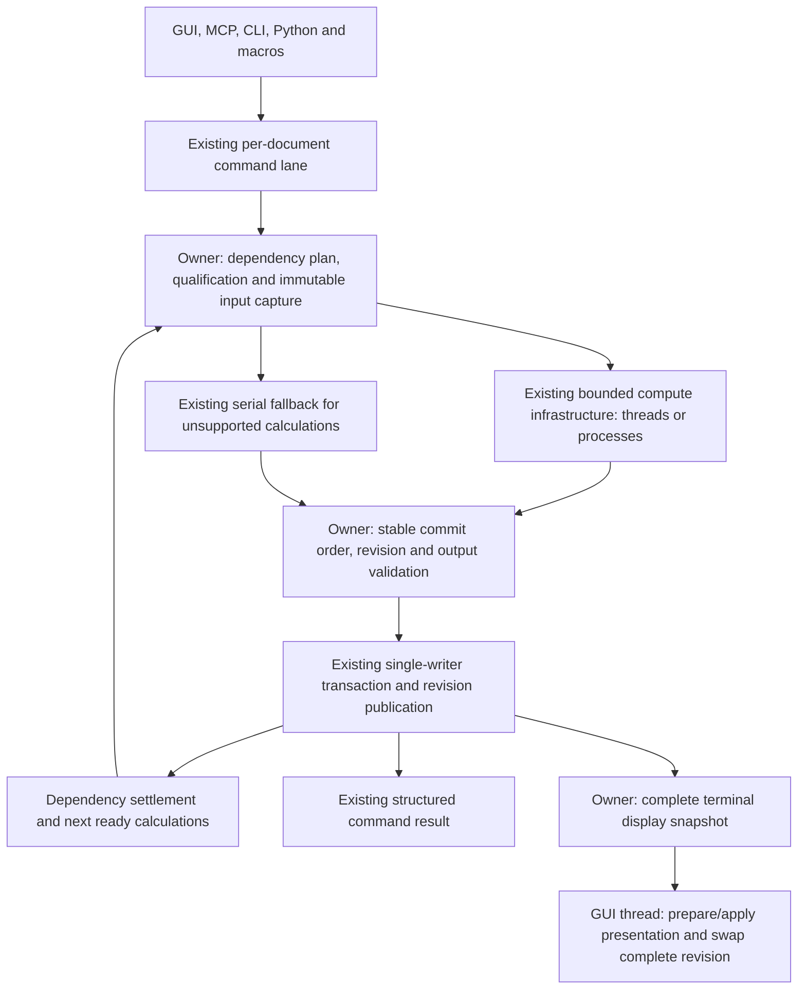

# Parallel recompute of independent objects inside one document

## Summary

Approve a measured, default-off pilot that lets explicitly qualified native Part
features compute from frozen inputs concurrently, beneath the existing recompute
command and per-document execution lane. Keep one writer per live document and
the current serial implementation as the behavioral reference. The fork already
has the scheduler, detached workers, revision validation, transactions and GUI
presentation boundary; this work qualifies calculations to use them together.
M0 must establish complete input/output contracts, working race checks and a
credible end-to-end benefit before M1 enables a small opt-in subset. M2 broadens
that subset only after equivalence, compatibility, resource and performance gates
pass. The owner is deciding whether to fund those gates and the pilot, not
approving general concurrent execution of live feature methods.

## Goals and non-goals

Goals:

- Reduce recompute wall time where the active dependency graph has independent,
  sufficiently expensive native calculations, especially separate Part Boolean
  branches and, eventually, independent Body histories.
- Preserve geometry, parametric history, naming, diagnostics, callbacks,
  transactions and undo behavior for each supported workflow.
- Keep GUI navigation on the last complete committed presentation while workers
  calculate. Bound CPU, memory, queued inputs and retained results globally.
- Make backend selection an implementation detail of existing GUI, Python,
  macro, MCP and CLI recompute entry points. Unsupported features retain their
  existing serial venue and existing capability refusals.

Non-goals:

- Concurrent mutation of live DocumentObjects, concurrent live `execute()` calls,
  a replacement execution engine, or a pool per document.
- A GUI-wide migration to a shared operation API. A shared modeling operation
  API for MCP/CLI is a separate track and is not a prerequisite for this plan.
- New persistence formats, mandatory object types, or a saved parallelism flag
  that makes a document depend on this fork.
- Parallel Python proxies, Spreadsheet evaluation, Sketcher solving, Assembly
  solving, structural edits, cyclic components or unknown add-ons in the pilot.
- Speeding up a linear feature history by adding DAG workers. Faster individual
  OCC/solver algorithms and faster presentation are separate opportunities.

## Evidence and its limits

### Baseline and provenance

All product references below were checked in `FreeCAD-start` at
`d7b0d2ffa7fce1ac21a5a9fdabdfd901fea434d8`. The MCP test references were checked at
its pinned submodule commit `8899541b41443e6c9d24faf5be620898420bf3f3`.
This document changes no implementation and reports no new runtime measurements.
The following read-only inputs, dated 2026-10-28, supplied the evidence:

| Input | Source supplied for this plan |
| --- | --- |
| Owner/reviewer requirements | `/home/rchiemstra/code/agents/p5-plan/review-inputs.md` |
| P1 architecture audit | `/home/rchiemstra/code/agents/p1-arch-audit/repo/research/REPORT.md` |
| P2 upstream landscape | `/home/rchiemstra/code/agents/p2-upstream/repo/research/REPORT.md` |
| P3 OCC experiment | `/home/rchiemstra/code/agents/p3-occ-limits/repo/research/REPORT.md` |
| P4 document DAG experiment | `/home/rchiemstra/code/agents/p4-dag-limits/repo/research/REPORT.md` |

These are local research artifacts, not files installed with FreeCAD. Retain the
reports and raw results with the implementation review. P4 contains all requested
major measurement sections; exclusions and absent measurements are listed below.

### P3: independent OCC operations

P3 used OCCT 8.0.1 release libraries, TBB disabled, with an optimized standalone
C++ harness. Each job owned newly constructed geometry and builders. Boolean
instances were non-destructive with internal parallelism off. The configured OCC
pool included the caller and was fixed before work. Twenty repetitions per
configuration gave these median wall milliseconds per fixed-size batch:

| Workload | Jobs | 1 thread | 2 threads | 4 threads | 8 threads | 8-thread speedup |
| --- | ---: | ---: | ---: | ---: | ---: | ---: |
| Box | 512 | 8.889 | 5.368 | 3.345 | 2.266 | 3.92x |
| Cylinder | 1,024 | 5.823 | 3.713 | 2.094 | 1.489 | 3.91x |
| Fuse | 16 | 83.869 | 47.458 | 23.616 | 14.976 | 5.60x |
| Cut | 16 | 71.936 | 39.451 | 21.365 | 16.202 | 4.44x |
| Common | 16 | 75.448 | 40.802 | 29.724 | 13.859 | 5.44x |
| Fillet | 8 | 34.902 | 20.592 | 12.721 | 8.476 | 4.12x |
| Offset | 8 | 22.424 | 11.649 | 7.143 | 4.581 | 4.90x |
| Prism | 512 | 14.514 | 6.589 | 3.544 | 2.576 | 5.63x |
| Independent meshes, inner parallelism off | 8 | 449.495 | 201.058 | 104.816 | 66.691 | 6.74x |
| Independent meshes, inner parallelism on | 8 | 492.220 | 194.578 | 139.185 | 66.462 | 7.41x |
| One large Cut, inner parallelism on | 1 | 91.302 | 60.945 | 48.851 | 47.691 | 1.92x |
| One compound mesh, inner parallelism on | 1 | 192.980 | 96.772 | 85.580 | 33.309 | 5.56x |

The last two speedups use explicit serial controls of 91.513 and 185.355 ms,
respectively, rather than their parallel-enabled one-thread times. The outer
launcher reserved the OCC pool in the independent-mesh experiment; nested mesh
work could fall back to its caller. This was bounded nesting, not eight outer
jobs each creating eight inner workers. Different one-thread mesh baselines
explain much of the apparent 7.41x versus 6.74x difference.

All 1,000 timed runs, including 720 multithreaded runs, passed checks on 170,440
result shapes. Checks included BRep validity and area/volume within 1e-9 relative
error; maximum observed errors were 6.5207e-16 area and 8.5861e-16 volume.
Mesh checks included status, per-face triangulations and serial triangle counts.
These checks do not establish topology, naming or mesh-vertex equivalence.

The timer excluded input construction except in primitive-construction rows,
validation and result destruction. It excluded all FreeCAD input capture,
serialization, property updates, TNP, transactions, Python and presentation.
Simple warm analytic shapes, uncontrolled background CI load and one non-TBB
OCC build limit generalization. Cold initialization, shared topology, splines,
invalid inputs, cancellation, import/export and error callbacks were untested.
Tiny primitive costs (about 17.4 microseconds per box and 5.7 per cylinder) argue
against dispatching one worker job per primitive for performance.

**The race gate is open.** P3's ThreadSanitizer executable exited 66 before the
benchmark with `unexpected memory mapping`; OCC libraries were uninstrumented.
No working race-detector result exists. Successful repeated outputs are useful
evidence, not a thread-safety qualification.

### P4: document width and critical paths

P4 timed 2,061 forced single-object API calls over three passes on 687 objects
in ten settled documents. Weights are per-object median wall times. Graphs use
the full object `OutList`, including expressions and ownership links, rather
than the production property-level dependency graph. All accepted graphs were
acyclic with no external links. Each call had exactly one matching completion
callback, with valid, settled objects afterward. Callback intervals were not
used as execution durations.

`W` is summed object weight, `C` the longest weighted path, and Whole a separate
all-touched whole-document recompute. Levels count vertices. These are seconds
from an **ASan/debug FreeCAD build**, not optimized-build predictions:

| Workload | Objects / edges | Levels | Max / average level width | W | C | W/C ceiling | Whole |
| --- | --- | ---: | --- | ---: | ---: | ---: | ---: |
| PartDesignExample | 28 / 73 | 22 | 7 / 1.27 | 0.9907 | 0.9666 | 1.025x | 1.2196 |
| TwoLengthsPadWithExpression | 11 / 12 | 4 | 7 / 2.75 | 0.0577 | 0.0320 | 1.80x | 0.0513 |
| TwoLengthsPadCrossObjectRef | 13 / 19 | 6 | 7 / 2.17 | 0.0904 | 0.0633 | 1.43x | 0.0885 |
| ModelFromV021 | 14 / 25 | 6 | 7 / 2.33 | 0.2104 | 0.1664 | 1.26x | 0.1785 |
| Sketch carbon copy | 26 / 35 | 4 | 14 / 6.50 | 0.1999 | 0.0691 | 2.89x | 0.1643 |
| Chain 50: one Body, 50 features | 59 / 108 | 51 | 8 / 1.16 | 9.7727 | 9.7322 | 1.004x | 8.8335 |
| Bodies 20: box and hole per Body | 229 / 269 | 4 | 167 / 57.25 | 2.0286 | 0.0593 | 34.20x | 2.2549 |
| Booleans 24: Cut then Fuse per branch | 120 / 96 | 3 | 72 / 40.00 | 1.8283 | 0.0790 | 23.15x | 1.8788 |
| AssemblyExample | 54 / 93 | 5 | 20 / 10.80 | 0.8309 | 0.4887 | 1.70x | 0.8826 |
| Spreadsheet driving 12 Sketch/Pad Bodies | 133 / 156 | 3 | 97 / 44.33 | 1.1380 | 0.0579 | 19.66x | 1.1647 |

For this weighted graph, `T_p >= max(W/p, C)`; therefore speedup cannot exceed
`min(p, W/C)`. P4 also modeled nonpreemptive greedy list schedules. Each cell
below gives unrestricted DAG / policy-constrained speedup, with Python and
Sketch work sharing one serial resource in the policy model:

| Workload | 2 workers | 4 workers | 8 workers |
| --- | ---: | ---: | ---: |
| PartDesignExample | 1.01 / 1.01 | 1.02 / 1.02 | 1.02 / 1.02 |
| TwoLengthsPadWithExpression | 1.80 / 1.80 | 1.80 / 1.80 | 1.80 / 1.80 |
| TwoLengthsPadCrossObjectRef | 1.43 / 1.43 | 1.43 / 1.43 | 1.43 / 1.43 |
| ModelFromV021 | 1.26 / 1.15 | 1.26 / 1.15 | 1.26 / 1.15 |
| Sketch carbon copy | 2.00 / 1.58 | 2.89 / 1.58 | 2.89 / 1.58 |
| Chain 50 | 1.00 / 1.00 | 1.00 / 1.00 | 1.00 / 1.00 |
| Bodies 20 | 1.99 / 1.99 | 3.91 / 3.91 | 7.64 / 7.64 |
| Booleans 24 | 1.99 / 1.99 | 3.94 / 3.94 | 7.73 / 7.73 |
| AssemblyExample | 1.29 / 1.17 | 1.50 / 1.25 | 1.62 / 1.28 |
| Spreadsheet fan-out | 2.00 / 2.00 | 4.00 / 3.99 | 7.84 / 4.26 |

These are modeled schedules, not measured parallel recomputes, optimal schedule
proofs, or promises for this pilot. Their weights include owner dispatch,
expressions, planning, commit, notification and waiting that cannot all move to
workers. The model also allows completion/priority orders the compatibility
policy below may forbid. The 20-body graph spends 71.3% of measured work on 189
auxiliary/container objects. Zeroing structural weights as a sensitivity check
reduces its ceiling to 14.84x and its ideal eight-worker estimate to 7.09x; it
reduces the tiny expression-pad ceiling to 1.00x. This is not corrected timing
data. `W/Whole` ranges from 0.812 to 1.217, so separate object requests are not an
additive profile of one recompute.

Sketches consume 58.6% of the carbon-copy workload and 21.2% of spreadsheet
fan-out. In AssemblyExample, Python joints consume 19.9% and one native Assembly
object 55.3% (0.4596 s). That native solver also calls Python and moves multiple
objects; visual component count is not independent solver work.

The executable's exact revision is unverified: runtime reported 27.1.0 Dev Build
with an empty BuildRevisionHash. Assembly required local source Python modules
to restore its real 17 joint proxies; the initial incomplete restore was
discarded. EngineBlock was excluded because Draft proxies could not restore
(`lazy_loader` and `Draft_rc` support missing). BIM/Arch/FEM/CAM were not sampled.
Peak process RSS was 1,062,936 KiB, about 1.01 GiB, for serial experiments. No ASan
error log appeared; leak detection was disabled, and ASan is not a race detector.

Open measurements are a verified optimized build, dirty-subgraph incremental
edits, larger imported and user models, complete add-on restores, native compute
versus capture/commit timings, GIL waits, actual concurrent recompute memory and
end-to-end speedup. Neither P3 nor P4 supplies the last of these.

## Target architecture

The GUI box includes dispatch to existing bounded presentation preparation;
Coin/cache application and publication stay on the GUI thread. Workers never
hold a live document pointer, call property setters, manage undo, emit model
signals, or touch GUI objects. They calculate detached results. The lane validates
and commits. A changed input makes the result stale; it is discarded or captured
and calculated again, never accepted by weakening revision checks.

| Box / responsibility | Existing implementation and proposed extension |
| --- | --- |
| Callers and command lane | `src/Gui/DocumentExecutionIngress.cpp`, `src/App/DocumentExecutionLane.cpp` and `src/App/DocumentExecutionLane.h`; retain DocumentHandle admission and command/recompute identities. Ordinary lane recompute currently requests OwnerThread. |
| Dependency plan | `src/App/Document.cpp`: `recomputeAsync()`, `getDependencyList()`, `_recomputeFeature()`; `src/App/GenericIsolatedRecompute.cpp`: request construction and property-level dependencies. Preserve touched downstream closure, force/skip/freeze, partial scope, SCC handling and synchronous limited second pass. |
| Qualification and capture | `src/App/DocumentCollaborationService.cpp`, `src/App/CollaborativeOperation.h`, `src/App/PreparedEdit.h`, `src/App/GenericIsolatedRecompute.cpp`; add exact-type compute adapters, copied inputs and complete read/write contracts. |
| Scheduling and bounded compute | `src/App/DocumentRecomputeCoordinator.cpp`: `scheduleReady()` and `poll()`; `src/App/PreparedEditExecutor.cpp`, `src/App/GeometryJobManager.cpp`, `src/App/GeometryProcessBackend.cpp`; extend readiness, retained-result bounds and commit ordering, reuse cancellation/backpressure. |
| Serial fallback | `src/App/GenericIsolatedRecompute.cpp`: GenericRecomputeInProcessOperation runs authoritative live execution inside owner commit. Isolated generic execution exports a closure and executes one target in a separate FreeCADCmd, not a shared-process temporary document per thread. |
| Validate and commit | `src/App/DocumentCommitCoordinator.cpp`: `commitRecompute()` and prepared-edit validation; `src/App/DocumentRevisionIndex.h`; retain identity/epoch, read/write validation, exact effect coverage, postconditions, rollback and publication before observers. |
| Settlement and result | `src/App/Document.cpp`: `settleRecomputedFeature()` and recompute finalization; `src/App/RecomputeHandle.cpp`, `src/App/DocumentExecutionLane.cpp`; preserve diagnostics, counts and command status. |
| Presentation capture and GUI publication | `src/App/DocumentPresentationBoundary.h`, `src/Gui/DocumentPresentationCapture.cpp`, `src/Gui/PresentationDelta.h`, `src/Gui/DocumentPresentationCache.cpp`, `src/Gui/PresentationApplyScheduler.cpp`, `src/Mod/Part/Gui/DocumentPresentationCapture.cpp`; retain pointer-free packets and complete revision swap. |

The new work is the contract between those boxes. Increasing preparation thread
count alone does not help: the owner venue's preparation currently constructs an
operation whose expensive live execution happens in serial `apply()`. Generic
compatibility captures also publish `UnknownModelMutation`, invalidating sibling
captures; `refreshRevisionFenceAfterEachCommit` deliberately prevents overlap.

### Revision independence before scheduling independence

Use precise semantic read/write sets for qualified operations. Keep broad
unknown-mutation and structural reads as guards against unaudited edits; publish
the actual object/property effects of a qualified result instead of declaring
its computation an unknown mutation. Existing dedicated Part operations provide
an example of semantic publication in
`src/Mod/Part/App/CollaborativeBooleanOperation.cpp`; their current footprint is
not automatically suitable for native-feature recompute.

For siblings A and B, require `W_A` and `W_B` disjoint and neither write set to
intersect the other's read set. Shared read-only inputs are allowed only when
each calculation owns its geometry and naming state. Dependency readiness alone
cannot establish this. Existence, structure, schema, preferences, attachments,
old output naming state and implicit cache effects belong in the contract.

Compatibility operations keep their existing broad publications and serial fence.
A broad write, unknown callback, serial island or changed prerequisite invalidates
affected speculative inputs. Drain/discard them and recapture after that boundary.
Do not turn off revision checking, silently replace expected revisions, or treat
all commits from the same command as harmless. No wave-wide atomic transaction or
unrestricted revision rebasing is proposed.

M0 must verify that exact publications still invalidate existing prepared clients
and expose changes through the publication stream, including clients using broad
compatibility captures. If a workflow requires legacy per-feature broad effects
that cannot coexist with these contracts, that workflow stays serial. Changing
its public revision contract requires separate review. This is a gate, not an
assumption that changing one boolean flag makes siblings valid.

## Feature qualification contract

Qualification is granted to an exact adapter, type, instance restrictions and
OCC/build combination. It defaults to serial and is checked at capture and commit.
`canRecomputeOnWorker()` defaults true for native objects in
`src/App/DocumentObject.h`; it is not a same-process parallel-safety certificate.
Python async/document-thread declarations are separate capabilities.

Each proposed adapter must complete this template in its implementation review:

| Contract field | Required contents |
| --- | --- |
| Identity and admission | Exact runtime type, schema, extensions, proxy/subclass exclusions, allowed document/edit state, adapter version and supported library builds. |
| Reads and freezing | Every numeric/property value; input and old output shapes; links and subelements; evaluated expressions and their transitive sources; local/world placements and parent transforms; attachment and suppression state; TNP tags/maps/hasher/history; material, preferences, tolerances, document flags and ambient state. State how each becomes an immutable owned value. Mark fields absent by eligibility explicitly. |
| Owner phases | Link validation, expression input/output phases, extensions, material, attachment, naming and callbacks that remain on the owner, in their original semantic order. No speculative owner phase may introduce observable writes early. |
| Compute | Entry point accepting only copied values; no live objects, interpreter objects, registries, parameters or GUI calls. Prove independent topology/caches, private naming data, cancellation and resource limits. |
| Outputs and effects | Complete success and failure payloads, shapes/history/maps and allowed property changes, diagnostics, touch propagation and publication keys. Structural/dynamic/cross-object writes require explicit contracts or rejection. Prop_Output alone is insufficient. |
| Invalidation | Identity/epoch changes and every read/write revision, schema, dependency, configuration or capability change that rejects the result. Include shared source changes and preference generations even where no existing revision key covers them. |
| Commit and undo | Validation and postconditions, deterministic owner integration, notification trace, transaction nesting, rollback state and exactly-once application. |
| Qualification evidence | Serial-equivalence fixtures, negative eligibility tests, real overlap, race/error/lifetime checks, compatibility and whole-operation timing/memory. Record failed or missing evidence. |

If a reliable input freeze or complete effect set cannot be described, keep the
feature serial. Native C++ implementation, separate Bodies and successful
`supportsAsyncRecompute()` are insufficient evidence.

### Worked candidate: exact native Part::Box without attachment or expressions

This is a proposed narrow contract for a correctness pilot, not a claim that the
current Box method is already detached or qualified. Source anchors are
`src/Mod/Part/App/FeaturePartBox.cpp`, `src/Mod/Part/App/PrimitiveFeature.cpp`,
`src/Mod/Part/App/AttachExtension.cpp`, `src/Mod/Part/App/PartFeature.cpp` and
`src/Mod/Part/App/PropertyTopoShape.cpp`.

1. **Admission.** Exact `Part::Box`, restored and settled schema, no Python
   proxy/subclass, no dynamic properties or extra extensions. Its built-in
   AttachExtension must be inactive, without support or base attachment, with no
   pending mapping work. Reject expression bindings, external references,
   restore/migration flags, cyclic membership and unknown callbacks/effects.
   Live object state and transactions remain under the owner. Known observers
   still run there; arbitrary mutating observers force serial execution.
2. **Inputs.** Copy Length, Width and Height in internal units, Placement,
   `Precision::Confusion()` and the admitted attachment/status configuration.
   Capture instance/epoch, stable object identity, schema/type/extensions,
   document structure, target model/existence/structure, all read and output
   property revisions and the unknown-mutation guard. Record force/freeze/touch
   state for the serial admission rules. There are no input shapes, links,
   expression sources, parent-transform calculations or material lookups in the
   worker. ShapeMaterial and unrelated properties must remain unchanged.
3. **Naming input.** The existing setter uses `Shape.setValue(result, false)`;
   old output mapping state cannot simply be discarded. Retain the old Shape
   map/tag and document hasher association for owner-only publication, with the
   output revision guarded. Do not send the document hasher or shared TopoShape
   caches to the worker. No duplicate-name collision repair is admitted.
4. **Compute.** Check dimensions against the captured confusion tolerance in
   the same Length/Width/Height order, preserving the existing diagnostics.
   Construct `BRepPrimAPI_MakeBox(L, W, H)` with new topology and return an
   unplaced raw shape or the translated modelling failure. No temporary App
   document or call to `Box::execute()` runs in the worker. No mutable global
   policy is changed. Check stop before/after the kernel; an active kernel may
   not be interruptible immediately.
5. **Outputs.** On success, only the target Shape plus normal recompute
   bookkeeping/diagnostics are permitted. On owner commit hold the same
   recomputing status, use the existing Shape setter semantics, apply Placement
   through the existing Part feature behavior, touch Shape as the base execute
   does, and run the admitted extension phase. Preserve its no-op mapping
   behavior. Settle the target and propagate touches using the existing code.
   There is no new object, link, schema, Placement or ShapeMaterial write.
   Declare target `ObjectProperty(Shape)` and `ObjectModel` effects for success;
   a modelling failure declares its error/bookkeeping `ObjectModel` effect and
   no Shape write. Capture expected revisions for the union of reads and writes.
   Touch propagation is owner scheduling state; any additional property effect
   discovered by qualification must be declared or must reject this contract.
6. **Validation.** Reject changed dimensions, Placement, Shape/naming inputs,
   attachment/status/schema, identity/lifetime, document structure, unknown
   mutation or relevant configuration before apply. Assert unchanged
   non-output properties and equivalent output validity, placement, named
   subelements, touch/error state and callback trace after apply. Roll back a
   postcondition failure; never publish a half-applied result.
7. **Failure/undo.** An invalid dimension preserves the old Shape and reports
   the serial diagnostic/error state; it is not a successful recompute. Keep
   existing exception translation and recompute counting. The owner uses the
   existing nested/internal transaction rules; the worker creates no undo entry.
8. **Example and qualification.** Two unlinked boxes of 10 x 20 x 30 mm and
   5 x 6 x 7 mm at different copied Placements can construct simultaneously.
   Gate their overlap with a latch, finish them in reverse order, and compare
   publication/observer order and outputs against serial. Change Length or
   Placement after capture to prove rejection; try attachment/expression/schema
   changes to prove loss of eligibility. Test the old naming map and saved face
   references after repeated dimension edits, undo and restore. The observed
   volume of the first box is 6,000 mm^3, but volume alone cannot pass the gate.

Box's `onChanged()` can recompute immediately when dimensions change. The adapter
must not repeat or move those owner-side writes during speculative preparation.
This path needs explicit trace tests. Boxes demonstrate safety and overlap; P3
does not justify claiming useful end-to-end speedup for such cheap kernels.

### Rejected example: two Assembly solves with apparently distinct results

Reject an adapter that freezes only each Assembly object's links and returns its
Shape or Placement. `src/Mod/Assembly/App/AssemblyObject.cpp` validates using
Python, reads solve preferences and writes Placements on other objects;
`src/Mod/Assembly/App/AssemblyObject.h` explicitly opts out of worker recompute.
Joint proxies, shared components and solver state make that proposed read/write
contract incomplete. Two different Assembly nodes are not two independent
calculations. Keep the entire solve and member updates serial, after required
geometry commits. Captured independent Part geometry inside an assembly can be
qualified separately; this does not qualify the Assembly solver itself.

## Execution model by operation class

Measure `T = capture + transfer/startup + compute + validation/commit + final
presentation` on the whole recompute's critical path, with peak aggregate RSS,
archive bytes and effective threads. Stages may overlap; summed per-task times
are diagnostics, not a replacement for wall time. Choose a venue per adapter
from warm/cold and small/large measurements. Processes own separate interpreters
and GILs; they do not eliminate the GIL. Native code releasing or not entering
Python can use threads only after its shared-state audit and race gate pass.

| Operation class | Pilot venue and reason | Gate for change |
| --- | --- | --- |
| Qualified primitive kernels | Detached threads for correctness after M0; otherwise serial. Numeric capture is small, but scheduling may cost more than compute. | Measured threshold/batching without changing commit/callback order; no performance claim from Box alone. |
| Qualified native Cut/Fuse/Common kernels | Reuse isolated geometry processes as the initial containment option; compare audited detached threads after the race gate. Deep-copy operands in either venue. | Whole-operation benefit including copy/archive/startup, private TNP integration and failure paths. Existing process adapter is a reference, not permission to execute the native feature concurrently. |
| Fillet/chamfer/offset/refine/sweep and selected PartDesign features | Serial until individual contracts; processes where existing isolation is appropriate. | Algorithm/OCC-version qualification, attachment/material/suppression/history and naming equivalence; then compare venues. |
| Generic compatibility recompute | Existing owner execution or existing explicitly isolated venue, with serial capture fence. | No broad parallel eligibility from the generic manifest or worker flag. |
| Python proxies, Python extensions, GUI callbacks | Existing serial owner/GUI-marshalled contract, including existing refusals. | Separate project for reproducible isolated proxy semantics; never concurrent shared-interpreter callbacks here. |
| Expressions and Spreadsheet | Owner-only serial barriers; downstream geometry may consume committed frozen values. | No concurrent parse/evaluate/import. Expression-bound feature phases remain serial until an adapter preserves their effects and ordering. |
| Sketcher/Eigen and Assembly solve | Serial domains initially; Assembly remains one coupled node. | Independent solver contexts and measured benefit would need separate qualification. |
| Links/groups, structural edits and SCCs | Serial, including authoritative link resolution and cache warming during capture. | SCC edge removal for compatibility never implies independence. |
| Meshing/presentation | Existing presentation providers, outside feature compute. | Detached topology and shared CPU tokens; GUI scene changes remain serialized. |

### One CPU and memory budget

Use application-wide admission over the existing pools across document lanes,
geometry processes, OCC/TBB work and presentation preparation. Current source
defaults are four preparation threads on a 16-logical-CPU host and two active
isolated geometry jobs, with queue capacities 64
(`src/App/PreparedEditExecutor.cpp`, `src/App/GeometryJobManager.h`). These are
capacities, not measured utilization or a budget for multiplying nested pools.

For this shared 16-logical-CPU, 15 GB machine, start qualification runs with two
outer calculations and one OCC thread each. Propose a four-CPU total experimental
cap across this feature's work; reserve capacity for the GUI and CI. A job using
`k` effective inner threads consumes `k` tokens including its caller; the sum of
active reservations must not exceed the cap. At a wide frontier use outer
parallelism with Boolean inner parallelism off. At a narrow frontier one job may
use the reserved inner allowance. Include worker processes' inner threads, not
only their process count. Eight-thread P3/P4 comparisons are evidence, not defaults.

Freeze global OCC defaults and preference snapshots before a run. Never toggle
global `SetParallelMode`, allocator, messenger or mesh defaults from workers.
Existing Boolean helpers request internal parallelism and BOP checking writes a
global default in `src/Mod/Part/App/TopoShape.cpp`; an adapter must bypass/adapt
those paths with explicit instance policy or stay serial. Verify TBB and OCC pool
behavior independently; P3 tested only the latter. Unbudgeted providers or
libraries prevent simultaneous admission rather than silently oversubscribing.

Initially retain at most two captured/running/completed feature payloads per
document, also subject to global admission. Count completed results awaiting
their commit turn against the bound. Propose a 2 GiB aggregate detached-input,
result and worker-memory allowance for experiments; measure process baselines
and reserve headroom before admitting a job. The owner must confirm/tune this
limit from M0 data. Oversized or poorly estimated jobs run serially; do not
duplicate a huge model merely to fill workers. Record application and child peak
RSS and CI contention; a pool slot alone is not a memory bound.

## Determinism, failure taxonomy and undo

### Scheduling and public effects

Dependency order is mandatory. Capture consumers only after prerequisites commit
successfully, with current values and revisions. Keep cyclic components and
unknown-effect operations as serial islands. Preserve property-level input edges,
initially clean downstream nodes and partial-recompute scope; do not substitute
P4's coarse graph for production dependency semantics.

Use the existing serial coordinator's stable ready-name selection to define
commit order, including its newly ready descendants. Compute may look ahead over
a bounded set of qualified, conflict-free ready siblings, but retain completed
results until their serial commit turn. For `A -> B` and independent `Z`, serial
may commit A, B, Z; a frontier barrier committing A, Z, B would change property
callbacks. Therefore a sorted wave alone is insufficient. Derive the expected
sequence using serial readiness, update it for blocked/failed nodes, and suspend
speculation across unknown effects or dependency/schema changes. Cost estimates
may choose which safe future work to prepare, never the public commit order.

Do not execute live expression writes or attachment updates early to manufacture
inputs for lookahead. Those effects stay at their original owner phase; M1
excludes expression/attachment cases it cannot freeze without such writes.
Model-property notifications are released only after the corresponding validated
publication, in serial order. Final `signalRecomputedObject` notifications
currently follow snapshot name order, then the presentation/recomputed/stable
boundaries; preserve that separately from execution order. Workers emit no model
signals. Retain `src/App/MainThreadSignal.h` GIL-release/marshalling rules and
avoid waits while holding the GIL, model, queue or presentation locks.

TNP integration is owner-only and ordered: preserve source history, target tags,
element maps, hasher identities and intended subelement references. A mutex on
the document StringHasher prevents corruption but would not make concurrent ID
allocation deterministic. Shallow TopoShape copies can still write caches and
shared TShapes (`src/Mod/Part/App/TopoShapeCache.h`,
`src/Mod/Part/App/PropertyTopoShape.cpp`, `src/App/StringHasher.cpp`). Use private
geometry/naming state with deterministic integration, or reject the feature.
Exclude duplicate-name repair cases initially: `src/App/ElementMap.cpp` contains
a release-build random suffix path. Semantic reference stability is required;
byte-identical FCStd archives, including timestamps, are not the criterion.

### Failure policy

Ordinary recompute retains current partial-success semantics. Unrelated branches
finish and keep valid commits; dependents of a noncommitted/failed prerequisite
never run using its old Shape. An enclosing edit command retains its existing
transaction policy and may roll back the whole edit. The backend does not add
wave-wide rollback or silently change which command is atomic.

| Failure class | Required outcome |
| --- | --- |
| Modelling failure / invalid dimensions or kernel failure | Preserve the serial diagnostic, error/touch state and recompute count. A committed failure state is still failed recompute. Block consumers; allow unrelated branches under the command policy. |
| Failed prerequisite | Mark dependents Blocked, never evaluate them from stale cached outputs. Preserve dependency diagnostics. |
| Stale input, schema, preference or identity | No apply. Report Stale/Conflict; recapture only under the existing command's retry policy and lifetime checks. A sibling's legitimate disjoint commit must not cause artificial staleness. |
| Invalid worker payload / postcondition or apply failure | Reject or roll back that feature's apply, publish no partial success. Validate schema, permitted outputs and naming as well as geometry. |
| Worker crash / resource exhaustion | Fail affected computation, reclaim its resources, block consumers and preserve earlier commits according to command policy. Process isolation is containment, not successful recovery. |
| Cancellation / close / late completion | Check stop before capture/compute/apply; discard uncommitted results, drain jobs without holding owner locks, invalidate by instance/epoch. Already committed features survive ordinary cancellation. Never kill an in-process owner or compute thread. |
| Presentation admission Busy before apply | Retain the same prepared payload and retry validation/admission once available. Do not rerun possibly applied work; bound retained payloads and allow cancellation. |
| Timeout / uncertain completion seen by MCP or another caller | Preserve the operation identity and inspect its authoritative command/commit status. Never blindly repeat a possibly committed edit. Distinguish not admitted, running/stalled, committed with readback failure, and confirmed no-apply failure. |

Native cancellation is cooperative; a long kernel may delay it. Only isolated
processes may be terminated for containment. Timeout does not guarantee a bound
on live synchronous execution. Keep stable terminal failure presentation and
the previous complete view if presentation itself fails. M0 must resolve/test
the existing difference between `RecomputeHandle::wait()` terminal finalization
and the lane's Completed-only finalization; do not assume identical partial
failure/cancellation signal and display behavior today.

### Undo and rollback

Preserve the current serial recompute's undo behavior exactly. It is neither an
undo entry per worker nor automatically one entry per recompute.
`src/App/DocumentCommitCoordinator.cpp` uses internal per-feature transactions
without retaining separate recompute undo entries, parks and folds into an open
caller transaction, and applies derived recompute within its enclosing commit.
Workers never own transactions. Preserve rollback of identity/object order,
properties, touched/scheduling/error state, pending removals, notifications and
revision publication, not just the visible Shape. Compare open-transaction,
closed-transaction, derived-command, failure and cancel cases with serial undo
and redo traces before enabling an adapter.

## Compatibility by kind

The promise is scoped and tested, not a blanket assertion that every fork object
or add-on works upstream.

| Kind | Required compatibility and boundary |
| --- | --- |
| Ordinary FCStd documents | Save in this fork, open and recompute in pinned upstream; save there, open and recompute here. Compare supported native histories, placements, expressions, naming references and error states. No new mandatory types or format. Do not persist scheduler/worker state. |
| Python and macros | Preserve signatures, return values/counts, exceptions, callback ordering/context and undo for supported workflows. Run unchanged fixtures in serial, parallel and upstream builds; adding a backend parameter to macros is excluded. |
| MCP and CLI | Existing recompute commands, result/error/commit identity and retry-safety semantics remain. Backend choice does not become a new modeling operation. A shared operation API remains a separate MCP/CLI track. |
| Add-ons | Explicitly test named versions, initially Assembly3 hooks, representative Draft/Arch proxies and a simple FeaturePython workflow, plus the pinned MCP addon. Unknown/unsupported cases keep their existing serial/refusal behavior; do not advertise universal compatibility. |
| GUI and presentation | Preserve lane admission, GUI affinity and last complete view. Test tree/property/selection/navigation while computation is held. Model-dependent edits retain Busy behavior; no mixed revisions or GUI refresh writes caused by the new path. |
| Intentional fork differences | Busy GUI synchronous calls may raise DocumentWouldBlock; unsupported presentation providers have no GUI-thread synchronous fallback. These predate this plan; see `doc/nonblocking_document_execution_and_gui_presentation_plan.md`. Report upstream differences separately from pilot regressions. |
| Fork-only objects | Assembly review notes (`src/Mod/Assembly/App/ReviewNote.cpp`) are outside ordinary upstream document equivalence. Keep them serial and explicitly test/document upstream unknown-type behavior separately; this plan adds no such type. |
| Source integration | Small adapters and scheduler changes reduce conflict surface. They cannot guarantee conflict-free upstream merges or identical internal execution architecture. |

Nominate upstream commit
[`74168a8ae2d0c1a6e3006297673a871e8c1c8399`](https://github.com/FreeCAD/FreeCAD/commit/74168a8ae2d0c1a6e3006297673a871e8c1c8399)
as the initial compatibility baseline, resolved from the upstream API on
2026-10-28. M0 must build/record that exact SHA with OCC/Python/compiler/add-on
versions and archive hashes; no upstream execution has been performed for this
plan. Changing the pin requires a recorded compatibility run, not a moving main
reference. Use compatible library versions to separate backend regressions from
kernel/version differences.

## Test plan

The current serial implementation is the oracle. Existing tests are starting
points, not proof of the new backend. Extend
`tests/src/App/DocumentRecomputeCoordinator.cpp`,
`tests/src/App/GenericIsolatedRecompute.cpp`,
`tests/src/Mod/Part/App/ShapeCacheIsolatedRecompute.cpp` and
`tools/mcp/freecad-mcp/tests/native/test_native_pad_feature.py`.

| Test group | Cases and passing condition |
| --- | --- |
| Qualification/input freezing | Exact allowed type and closure, negative subclasses/proxies/extensions/schema; every declared input changed after capture must reject. Check no worker live-object access, no shared TShapes/cache/hashers and no undeclared outputs. Include cold and warm caches. |
| Serial versus parallel equivalence | Same parametric history, object identity/order, Body Tip, expressions, attachment, placement, materials, error/touch state and execution counts. Compare BRep validity, topology and geometry within recorded tolerances (area/volume alone is insufficient), TNP history and referenced faces/edges. Save/restore both results. |
| Parametric edits and naming | Change a spreadsheet cell and sketch dimensions/constraints repeatedly; binders, fillets, attachments and downstream references must stay on intended geometry through recompute, undo/redo and save/open. Pilot exclusions must select serial, not omit these workflows. |
| Actual overlap and ordering | Two qualified native computations rendezvous on a barrier/latch before either is released. Reverse completion order; assert both were active, serial commit order, exactly-once callbacks and correct A/B/Z ordering. Never use sleeps to establish overlap. Include one-worker control and bounded retained-result checks. |
| Hidden dependencies | Separate Bodies sharing a spreadsheet, linked shape, subelement or placement source: detect read/write conflicts/edges or select serial. A shared input shape needs independent captures even for read/read consumers. Include diamonds, nested Parts/Links and external-source edit/close. |
| Scheduler semantics | Initially clean downstream nodes, force/SkipRecompute/Freeze/no-recompute, partial requests, fine-grained input/output properties, second pass, SCC serial islands, queue saturation and concurrent document lanes. No skipped work or cyclic features treated as independent. |
| Failure and lifetime | Prerequisite failure, sibling success, modelling error, invalid payload, apply/postcondition failure, cancel before/during/after compute, worker crash, stale revision, preference change, close/reopen with reused name, late completion and presentation-admission delay. No stale write, duplicate commit, deadlock, leaked authority or false success. |
| Transactions and observer reentrancy | Undo/redo/rollback versus serial with and without an open caller transaction, derived edit, partial failure and cancellation. Compare notification order and observer readback; mutating/reentrant observers must trigger the existing guard or serial barrier. |
| GUI integrity | Hold workers using latches while navigating/selecting/inspecting the last committed snapshot. Verify responsiveness, single complete revision swap, no unintended model writes and correct terminal error view. Test cancelled/partial-failure paths separately from Completed. |
| Upstream and add-ons | Unchanged macro/FCStd fixtures in both directions against the pinned upstream build, with intentional differences separately asserted. Restore real proxies and test the named add-on matrix; null proxies/stubs cannot pass. |
| Performance and resources | Multi-body documents, independent Booleans, real assemblies and a linear PartDesign control; all-touched and local edits. Compare serial and two/four workers, both venues and OCC inner budgets. Record wall distributions, capture/transfer/compute/commit/presentation, GIL waits, peak parent/children RSS, bytes and actual concurrency. |

Retain the regression scenario from
[fork PR #114](https://github.com/Rchiemstra/FreeCAD/pull/114): deferred datum GUI
refresh wrote Length/Width and changed a revision between capture and validation.
Extend `PartPresentationCaptureTest.UnchangedDatumExtentsPreserveRevisionFence`
in `tests/src/Gui/DocumentPresentationCache.cpp` together with coordinator
presentation-admission tests. Unchanged refresh must not invalidate work; a real
size change must still reject an old capture. Delayed admission must reuse its
payload exactly once. The fix is not permission to ignore revision conflicts.

CI layering:

- Every implementation PR: fast contract/architecture tests plus relevant native
  coordinator/adapter tests. Add meaningful regression tests for fixes; do not
  skip or weaken existing checks. Update generated `tests/architecture/`
  inventories when source changes move their findings.
- Separate required qualification jobs before enabling/broadening: live GUI,
  pinned upstream/add-on compatibility, repeated concurrency/failure tests,
  optimized performance/memory and sanitizers. ASan/UBSan complement a working
  race detector; they do not replace it. Instrument relevant FreeCAD and OCC
  code and document detector limitations for each supported backend/build.
- Use the branch-built native qualification lane. The pinned MCP script
  `tools/mcp/freecad-mcp/ci/qualify_pad_feature.py` with `--native` rejects a FreeCAD stub and sets
  `FREECAD_MCP_REQUIRE_NATIVE_COLLABORATION=1`; the qualification harness must
  also reject empty/skipped native runs. Its existing live GUI runner
  `tools/mcp/freecad-mcp/scripts/run_live_gui_tests.sh` already rejects skips.
  Mock/adapter success is not native qualification.

For implementation checks, system Python tests use
`uv run --no-project --with pytest python -m pytest ...`; MCP tests use its own
`uv run ...` project commands. No full build or runtime qualification is requested
by this documentation change. Future builds run through CI, with at most six
parallel build jobs on this shared machine; serialize heavy sanitizer and
performance jobs and record competing load.

## Phased milestones and exit criteria

Estimates are engineering effort for one engineer familiar with this fork,
including tests and review fixes, excluding CI queue time or a separate OCC
upgrade. Exit failures can stop a phase; they are not dates for automatic rollout.

### M0 — measurements, contracts and race gate (roughly 2–4 engineer-weeks)

PR slices:

1. Add opt-in timing and reproducible fixture capture around input preparation,
   native execution, transfer, commit and presentation. Record build identity,
   active dirty DAG, observed overlap, CPU budget and aggregate memory; retain
   the two narrow histories as negative controls.
2. Add the qualification template/negative contract tests and a detached
   geometry harness for the proposed Box and Boolean subset, without changing
   production scheduling. Audit cache/TShape sharing, callbacks, naming and
   OCC global settings; compare serial and process/thread costs.
3. Establish working instrumented race runs, cold/error/cancel coverage and
   compatibility baseline fixtures. Add publication-contract and callback-order
   tests, including A/B/Z and PR #114, before relaxing any generic serialization.

Exit: verified optimized build and pinned upstream results; complete candidate
input/output/invalidation contracts; measured capture/compute/commit/memory for
wide and narrow workloads; functioning race checks for admitted same-process
kernels with no unresolved relevant findings; safe process transport/lifetime
checks for isolated work; demonstrated sibling-compatible exact publication
that still rejects real/broad conflicts and informs existing clients. A justified
cost/venue decision and feasible end-to-end gain must support M1. Failed TSan
startup is not a pass. If instrumented kernel coverage remains unavailable, keep
thread adapters disabled; any narrower process-only pilot needs an explicit
owner decision and its own completed isolation/transport checks.

### M1 — opt-in native-feature pilot (roughly 4–6 engineer-weeks)

PR slices:

1. Introduce default-serial capability registration and precise capture/effects
   for the narrow Box contract, behind a default-off runtime preference. Keep
   file/Python/MCP formats unchanged. Land owner-only publication/naming tests.
2. Extend existing coordinator readiness/retention and serial commit sequencing
   for two admitted independent calculations, with shared CPU/memory admission.
   Add latch overlap, reverse completion, stale/cancel/crash/undo and bounded
   presentation-admission retry tests.
3. Add individually audited native Part Cut/Fuse/Common adapters as the small
   performance subset, initially restricting links, expressions, refine and
   naming cases to what has passed its contract. Reuse existing geometry jobs;
   choose process/thread per M0 costs and qualification. No generic allowlist
   for all Part features and no GUI-wide operation-API migration.
4. Add branch-built GUI/MCP and pinned upstream/add-on qualification, repeated
   concurrency and optimized end-to-end benchmark jobs; document supported
   instances, exclusions, diagnostics and the single preference to disable it.

Exit: serial-equivalent supported behavior, full compatibility/race/lifetime
matrix without skipped native tests, real native overlap, no stale or duplicate
apply, bounded resources and useful end-to-end gain. Proposed performance gate:
at least 1.20x median whole-recompute speedup on a representative independent
Boolean document at two or four CPU tokens, repeated with published variability;
no more than 5% median regression on narrow/small controls, with serial fallback
when overhead dominates. Owner confirms these thresholds after M0 noise data.
Box overlap alone cannot satisfy this gate. Pilot stays default off; model
validity, naming and compatibility take precedence over a favorable timing.

### M2 — broaden qualified coverage (roughly 4–8+ engineer-weeks per family)

PR slices:

1. Expand measured user/imported-model corpus and incremental-edit cases; repair
   missing real add-on restores and collect eligibility/serial-fraction data.
2. Qualify a selected expensive Part family, then selected independent
   PartDesign histories, one contract/adapter and regression set at a time.
   Audit Body Tip, suppression, material, attachment and naming before admission.
3. Improve measured batching, crossover thresholds, CPU/memory estimates and
   scheduling lookahead while retaining public commit order. Compare narrow
   frontier OCC internal parallelism and wide frontier outer parallelism.
4. Refresh upstream adapters and compatibility jobs. Propose any default change
   separately with corpus evidence and a documented rollback preference.

Exit per family: all M1 behavior, compatibility and race gates; representative
end-to-end improvement within the same resource bounds; no unsupported feature
silently admitted. Python, Sketcher, Spreadsheet and coupled Assembly solve
remain serial unless a separately reviewed project proves their contracts.
No claimed gain for a chain whose critical path prevents it.

## Risks and open questions for the owner

1. **Budget and go/no-go.** Approve M0 first and a conditional M1, or require a
   smaller experiment? Confirm the proposed 1.20x benefit/5% control thresholds
   and four-CPU/2 GiB experimental limits once release-build noise is known.
2. **Race qualification.** Where will compatible instrumented OCC/FreeCAD runs
   execute? P3's failed TSan launch leaves this unresolved. A process venue may
   contain a crash but still needs input/output, transport and lifetime safety.
3. **Publication and callbacks.** Can exact effects preserve every existing
   prepared-client invalidation and macro observer trace? If not, keep affected
   modes serial and review the specific contract change rather than relaxing
   guards. Stable serial commit order may reduce otherwise available overlap.
4. **Naming and capture cost.** Can Boolean history/maps be integrated privately
   and deterministically without spending the kernel gain on copying or owner
   TNP work? Shared inputs, cold caches and naming collisions are high-risk.
5. **Corpus and compatibility scope.** Which real large documents and exact
   add-on versions must qualify? P4 lacks working Draft/EngineBlock, large
   BIM/Arch/FEM/CAM coverage, incremental timings and a verified release build.
   Decide who retains the research artifacts and pinned upstream build results.

Other risks are process startup and serialization dominating small jobs, large
copied shapes exhausting memory, global OCC/progress callbacks bypassing CPU
policy, hidden Python calls in native features, terminal presentation differences,
and upstream changes touching execution and previews. Multiple document lanes do
not prove simultaneous live execution: the current process-scoped mutation and
presentation admission target in `src/App/MutationClassification.cpp` also limits
competing commits. Detached work must remain outside that boundary; measure
multi-document contention before making cross-document performance claims.

## Upstream strategy

Keep the independent-object backend separate from UI responsiveness and preview
work. [FPA proposal #36](https://github.com/FreeCAD/FPA-grant-proposals/issues/36)
explicitly excludes parallel document-DAG processing, and
[multicore issue #5581](https://github.com/FreeCAD/FreeCAD/issues/5581) mixes
several bottlenecks. A fast independent-kernel benchmark or a responsive GUI
does not establish whole-document recompute speedup.

P2's 2026-10-28 landscape review found upstream
[#21292](https://github.com/FreeCAD/FreeCAD/pull/21292),
[#21443](https://github.com/FreeCAD/FreeCAD/pull/21443) and fine-grained recompute
[#25603](https://github.com/FreeCAD/FreeCAD/pull/25603) already integrated into
this baseline. Do not plan to import them again. Its inspected open heads were
[#29757](https://github.com/FreeCAD/FreeCAD/pull/29757) `cf934a960708`,
[#32509](https://github.com/FreeCAD/FreeCAD/pull/32509) `50c5db044952`,
[#32193](https://github.com/FreeCAD/FreeCAD/pull/32193) `1b274f78fae9`, and
[#32553](https://github.com/FreeCAD/FreeCAD/pull/32553) `f421ae9bc00d`.
These are report snapshots, not promises about future PR state.

Coordinate with async/preview maintainers before implementation. Share the
serial-versus-parallel measurements, qualification contract and failure tests
first. Propose small upstreamable slices for instrumentation, detached kernels,
capability checks and resource/cancellation contracts; keep fork-specific lane
and presentation integration in narrow adapters. Reuse upstream preview
identities, cancellation and buffer isolation where compatible, preserving the
fork's owner, exported MainThreadSignal hook state and restricted waits.

P2 counted changed-path overlap of 62/192 files for #29757, 13/28 for #32509,
3/12 for #32193 and 0/4 for #32553 against a broad fork-change surface. These are
integration-risk indicators, not predicted conflicting hunks. Refresh actual
heads before an import. Review #32193's pool for concurrent callers/nesting
before reuse; its presentation pool is not a ready substitute for the existing
compute executor. Treat #32553's progress/event-pump proposal as unresolved,
not a deadlock guarantee. Historical process-abort
[#19710](https://github.com/FreeCAD/FreeCAD/pull/19710) was closed unmerged;
reuse the fork's current process backend instead of a new worker executable.

Small adapters reduce merge work but cannot guarantee upstream acceptance or
conflict-free merges. Every import refreshes the pinned compatibility and native
qualification gates before expanding the pilot.
